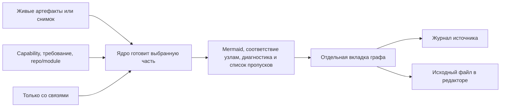

# Design

> Рендер из `decisions.json`, не править руками.

## Context

Мотивация и состав capabilities приведены в [proposal.md](proposal.md). Дизайн связывает новый публичный вывод ядра с отдельной вкладкой плагина. Подготовка выбранной части и соответствия элементов исходным узлам относится к ядру, показ и переходы выполняет плагин. Основание дают F-22.A и F-23.A.

В ядре уже есть выбор capability и требования, а в плагине есть Mermaid-рендерер и механизмы переходов. Обработчик кликов существующей схемы ограничен flowchart. Для requirementDiagram принята адресация через соответствие исходным id и местам из ответа ядра. Эти ограничения зафиксированы в F-09–F-11, F-19, F-20 и F-23.A.

Связи на схеме соответствуют F-22.A–F-24.A и F-45.E. Источник определяет состав исторической структуры, а переход к рабочему файлу сопровождается обозначением текущего содержимого. Эти два условия заданы F-02, F-23.A и F-44.A.

Опись исследовала 13 файлов и 48 веток. Принятые исходы F-40.A, F-41.A, F-43.A, F-44.A и F-45.E закреплены сценариями в specs. F-42.B сохраняет границу чтения снимков форматов 2 и 3 с явным отказом для формата 1. Перечень использованных механизмов и их цитаты приведены в [consequences.md](consequences.md).

- F-01 Критерий готовности: В плагине VS Code можно просмотреть req-graph активного изменения как Mermaid requirementDiagram.
  - openspec/changes/req-graph-viewer/intent.md «В плагине VS Code можно просмотреть req-graph активного изменения как Mermaid requirementDiagram.»
- F-02 Критерий готовности: Можно открыть сохранённый req-graph.json, в том числе из архива; показ исторической структуры опирается на снимок.
  - openspec/changes/req-graph-viewer/intent.md «Можно открыть сохранённый req-graph.json, в том числе из архива; показ исторической структуры опирается на снимок.»
- F-03 Критерий готовности: Основной сценарий — выбор части графа по capability или требованию; весь граф не показывается автоматически по умолчанию.
  - openspec/changes/req-graph-viewer/intent.md «Основной сценарий — выбор части графа по capability или требованию; весь граф не показывается автоматически по умолчанию.»
- F-04 Критерий готовности: Можно выбрать модуль по паре repo/module и увидеть требования, которые он реализует по явным связям implements, включая связи, полученные через файлы реализации.
  - openspec/changes/req-graph-viewer/intent.md «Можно выбрать модуль по паре repo/module и увидеть требования, которые он реализует по явным связям implements, включая связи, полученные через файлы реализации.»
- F-05 Критерий готовности: Требования, отобранные по модулю, показываются со связанными сценариями, задачами и решениями; другие модули их совместной реализации сохраняются как контекст.
  - openspec/changes/req-graph-viewer/intent.md «Требования, отобранные по модулю, показываются со связанными сценариями, задачами и решениями; другие модули их совместной реализации сохраняются как контекст.»
- F-06 Критерий готовности: Выбор модуля можно сузить до capability.
  - openspec/changes/req-graph-viewer/intent.md «Выбор модуля можно сузить до capability.»
- F-07 Критерий готовности: Диаграмму можно масштабировать, перемещать и вписывать в область просмотра; просмотр активного изменения поддерживает обновление.
  - openspec/changes/req-graph-viewer/intent.md «Диаграмму можно масштабировать, перемещать и вписывать в область просмотра; просмотр активного изменения поддерживает обновление.»
- F-08 Критерий готовности: Отсутствие структурных данных в старом снимке явно обозначается; оно не выдаётся за подтверждённое отсутствие модулей.
  - openspec/changes/req-graph-viewer/intent.md «Отсутствие структурных данных в старом снимке явно обозначается; оно не выдаётся за подтверждённое отсутствие модулей.»
- F-09 Селектор диаграммы ядра принимает capability и requirement.
  - core/trace/trace_graph.py «def select_diagram(graph: dict, capability: str | None = None, requirement: str | None = None) -&gt; tuple[list[dict], list[dict]]:»
- F-10 Просмотрщик схемы уже передаёт Mermaid-текст локальному рендереру.
  - src/scheme/page.ts «const { svg } = await mermaid.render(SVG_ID, view.text);»
- F-11 Обработчик клика по узлу существующей схемы пропускает только flowchart.
  - src/scheme/page.ts «if (moved || !flowchart) return;»
- F-12 Текущий список изменений плагина исключает каталог archive.
  - src/core/project.ts «return entries.filter((e) =&gt; e.isDirectory() &amp;&amp; e.name !== "archive").map((e) =&gt; e.name).sort().map((name) =&gt; changeRef(root, name));»
- F-13 Связанная структура требования уже входит в Mermaid-экспорт; транзитивные зависимости не включаются целиком.
  - core/openspec/specs/trace-diagram/spec.md «Связанная структурная ось SHALL включаться с необходимыми предками; все транзитивные зависимости не втягиваются автоматически.»
- F-16 Заморозка графа предусмотрена уже перед первой задачей реализации: наличие снимка само по себе не означает завершённости изменения.
  - core/docs/GUIDE.md «Перед первой задачей `/opsx:apply`: снимок и отчёт появляются до реализации.»
- F-19 В плагине уже есть адресный переход к записи журнала по id и открытие файла на строке.
  - src/viewer/viewerPanel.ts «reveal(id: string, mode?: ViewMode): void {»
  - src/file-links/openFile.ts «export async function openBeside(file: string, line: number | null): Promise&lt;void&gt; {»
- F-20 Исходные id и место at хранятся в узлах графа; подпись Mermaid очищается и обрезается до предела имени отдельно.
  - core/trace/trace_graph.py «return {"id": node_id, "kind": kind, "name": name, "at": f"{file}:{line}", **extra}»
  - core/trace/trace_graph.py «return clean_text(f"{ident} {label}")[:DIAGRAM["имя"]].rstrip()»
- F-21 Селектор включает дополнительные узлы записи через связи с центральными узлами выбранной части.
  - core/trace/trace_graph.py «if near in core and nodes[far]["kind"] in attach:»
- F-37 [канон] trace-graph-view/Вид графа готовится из выбранного источника: канон ИБ
  - openspec/changes/req-graph-viewer/specs/trace-graph-view/spec.md «### Requirement: Вид графа готовится из выбранного источника»
- F-38 [канон] plugin-trace-graph-view/Граф показывается отдельной вкладкой: канон ИБ
  - openspec/changes/req-graph-viewer/specs/plugin-trace-graph-view/spec.md «### Requirement: Граф показывается отдельной вкладкой»
- F-39 [канон] plugin-trace-navigation/Узел артефакта ведёт к исходному месту: канон ИБ
  - openspec/changes/req-graph-viewer/specs/plugin-trace-navigation/spec.md «### Requirement: Узел артефакта ведёт к исходному месту»

## Goals / Non-Goals

| Граница дизайна | Принятое условие | Основание |
| --- | --- | --- |
| Подготовка и показ | Ядро выбирает часть и выдаёт согласованные Mermaid-текст и соответствие исходным узлам. Плагин отображает ответ и выполняет переходы. | F-23.A |
| Состояние панели | Источник и фильтры принадлежат вкладке графа. Повторное открытие того же снимка фокусирует существующую вкладку с её фильтрами. | F-22.A, F-30.A |
| Принятие результата | Рисунок, карта переходов и список пропусков относятся к актуальному выбору. Сбой процесса даёт явный отказ, ошибка Mermaid очищает прежние рисунок и карту. | F-32.A, F-40.A, F-41.A |
| Наблюдаемость связей | Список пропусков имеет явную область, диагностика сборки доступна человеку. «Только со связями» убирает узлы без единого ребра в выбранной части, сохраняя диагностику и область списка. | F-24.A, F-45.E |
| Адресные переходы | Цель берётся из соответствия узлам. Переход к записи дожидается данных журнала источника. При переходе из снимка к рабочему файлу обозначается текущее содержимое. | F-18.A, F-23.A, F-43.A, F-44.A |
| Чтение и жизненный цикл | Живой просмотр доступен после формирования specs, до заморозки граф обозначен предварительным. Просмотр сохраняет файлы graph/, завершённость изменения определяется отдельно от наличия снимка. | F-14.A, F-15.A, F-35.A, F-36.A |
| Проверка безопасности | Парковки чтения источников и путей, Mermaid и CSP, целей переходов передаются в чек-лист security. | F-37, F-38, F-39 |

## Decisions

### F-14 С какого этапа человек должен иметь возможность просматривать граф изменения?

- **Выбрано:** A. Просмотр доступен начиная с шага specs, когда спецификации сформированы; наличие замороженного req-graph.json для этого не требуется.
- **Слово человека (2026-11-10):** «при этом я хотел бы иметь возможность просматривать граф начиная с шага specs, когда они сформированы. иначе, до момента формирования specs -- будет виден только набор несвязанных решений по развилкам, без привязки к другим артефактам и тем более требованию с идентификатором»
- **Обратимость:** обратимо — Это условие доступности и обозначение состояния в просмотрщике; изменение не требует миграции сохранённых графов.
- **Улики выбранного:** openspec/changes/req-graph-viewer/answers/2026-11-10-availability-word.md «при этом я хотел бы иметь возможность просматривать граф начиная с шага specs, когда они сформированы. иначе, до момента формирования specs -- будет виден только набор несвязанных решений по развилкам, без привязки к другим артефактам и тем более требованию с идентификатором»

### F-15 Как считать граф, который показан до заморозки?

- **Выбрано:** A. Граф, отрендеренный до заморозки, считается предварительным и не должен подаваться как конечный.
- **Слово человека (2026-11-10):** «так как граф замораживается в виде файла только на определенном этапе -- то граф, который мы можем рендерить до заморозки -- не должен считаться конечным.»
- **Обратимость:** обратимо — Это условие доступности и обозначение состояния в просмотрщике; изменение не требует миграции сохранённых графов.
- **Улики выбранного:** openspec/changes/req-graph-viewer/answers/2026-11-10-availability-word.md «так как граф замораживается в виде файла только на определенном этапе -- то граф, который мы можем рендерить до заморозки -- не должен считаться конечным.»

### F-17 Для какой основной проверки человек использует диаграмму на шаге specs?

- **Выбрано:** A. Визуально проверять связи решений по развилкам с требованиями и сценариями, включая отсутствие связей; не заставлять человека вычитывать артефакты для восстановления этой картины.
- **Слово человека (2026-11-10):** «хочу проверить связи решений по развилкам с требованиями и сценариями. то есть рендер графа может быть удобным инструментом, для того, чтобы видеть что с чем связано и связано ли вообще, вместо того, чтобы вычитывать текст для поиска таких связей.»
- **Обратимость:** обратимо — Назначение просмотра и условие добавления переходов уточняют поведение плагина; исторические графы и исходные артефакты не мигрируются этим решением.
- **Улики выбранного:** openspec/changes/req-graph-viewer/answers/2026-11-10-purpose-word.md «хочу проверить связи решений по развилкам с требованиями и сценариями. то есть рендер графа может быть удобным инструментом, для того, чтобы видеть что с чем связано и связано ли вообще, вместо того, чтобы вычитывать текст для поиска таких связей.»

### F-18 При каком условии в объём входит переход по клику на узел?

- **Выбрано:** A. Поддержать переход к развилке в просмотрщике или к артефакту в редакторе, если это возможно без сложных модификаций графа или артефактов. Это желательное удобство с ограничением стоимости, а не безусловное требование менять формат источников.
- **Слово человека (2026-11-10):** «если можем поддержать кликабельность, и переход к развилке в просмотрщике или к артефакту в редакторе -- то хорошо, но если для этого не нужно делать сложных модификаций графа или артефактов.»
- **Обратимость:** обратимо — Назначение просмотра и условие добавления переходов уточняют поведение плагина; исторические графы и исходные артефакты не мигрируются этим решением.
- **Улики выбранного:** openspec/changes/req-graph-viewer/answers/2026-11-10-purpose-word.md «если можем поддержать кликабельность, и переход к развилке в просмотрщике или к артефакту в редакторе -- то хорошо, но если для этого не нужно делать сложных модификаций графа или артефактов.»

### F-22 Где разместить просмотр req-graph относительно журнала, схемы и справки?

- **Выбрано:** A. Отдельная вкладка графа рядом с журналом; переиспользовать рендер и управление масштабом. Граф сохраняет свой источник и фильтры, схема и справка сохраняют своё назначение. Цена — отдельный контроллер панели и восстановление состояния; расположение легко поменять позднее.
- **Обратимость:** обратимо — Размещение меняется переносом контроллера и состояния панели; граф и исходные артефакты не мигрируются.
- **Улики выбранного:** src/protocol/protocol.ts «export type PanelView = "scheme" | "help";»
- **Улики выбранного:** src/viewer/viewerPanel.ts «reveal(id: string, mode?: ViewMode): void {»
- **Отвергнуто:** B. Добавить режим «граф» к существующей вкладке «схема / справка». Меньше отдельных вкладок, но источник графа и фильтры нужно согласовать со следованием схемы за текущим журналом; одновременный показ схемы и графа потребует дополнительного поведения.
- **Отвергнуто:** C. Встроить граф в страницу журнала. Карточки и диаграмма живут вместе, но Mermaid, масштабирование и отдельный источник архивного снимка усложнят страницу журнала. Позднее выделение графа потребует переноса состояния. — маловероятно: Просмотр архивного снимка должен работать и без открытого журнала; встраивание сильнее связывает эти независимые состояния.

### F-23 Где выполнять выбор подграфа и сохранять соответствие рисунка исходным узлам для переходов?

- **Выбрано:** A. Расширить публичный вывод ядра для просмотра: один ответ содержит Mermaid-текст выбранной части и соответствие её элементов исходным id/местам. Ядро принимает живой источник или снимок и выбор модуля; плагин рисует и обрабатывает переходы через существующие механизмы. Форматы исходных артефактов и сохранённых графов ради кликов не меняются. Цена — небольшой новый протокол и его проверка; возможность точного связывания с SVG закреплённой Mermaid нужно проверить интеграционно.
- **Обратимость:** обратимо — Форматы исходных артефактов и снимков сохраняются. Отмена потребует согласованной правки публичного ответа ядра и его вызова в плагине.
- **Улики выбранного:** core/trace/trace_graph.py «def diagram_text(graph: dict, capability: str | None = None, requirement: str | None = None) -&gt; str:»
- **Улики выбранного:** core/trace/trace_graph.py «return {"id": node_id, "kind": kind, "name": name, "at": f"{file}:{line}", **extra}»
- **Улики выбранного:** core/trace/trace_graph.py «return clean_text(f"{ident} {label}")[:DIAGRAM["имя"]].rstrip()»
- **Улики выбранного:** src/viewer/viewerPanel.ts «reveal(id: string, mode?: ViewMode): void {»
- **Улики выбранного:** src/file-links/openFile.ts «export async function openBeside(file: string, line: number | null): Promise&lt;void&gt; {»
- **Отвергнуто:** B. Получать JSON графа, а отбор, Mermaid-текст и соответствие узлов рассчитывать в TypeScript плагина. Снимок можно читать напрямую, но правила ядра о кандидатах, структуре, стилях и ограничениях придётся повторять и проверять на совпадение. Отказ от дублирования позднее потребует перенести логику обратно.
- **Отвергнуто:** C. Дополнить нынешний Mermaid-экспорт выбором модуля и снимка, а для кликов восстанавливать исходные узлы в плагине по сгенерированным именам и порядку нумерации. Ответ ядра короче, но плагин зависит от очистки и обрезки подписей; любое изменение генератора потребует синхронной правки. — маловероятно: Восстановление связи по производной подписи добавляет хрупкую зависимость именно в необязательное удобство кликов.

### F-24 Как показать отсутствие связей, когда выбранная часть графа скрывает остальные записи?

- **Выбрано:** A. Показывать выбранную диаграмму, а рядом — явный список записей и требований без найденных связей по данным сборки. Отдельно обозначать, относится ли список ко всему изменению или выбранной части. Из списка можно выбрать объект для осмотра; отсутствующие связи не дорисовываются. Цена — дополнительный список и понятная область его расчёта; это не автоматическая оценка смысла решений.
- **Обратимость:** обратимо — Список рассчитывается для показа; изменение его размещения или области расчёта не меняет сохранённые данные графа.
- **Улики выбранного:** core/trace/trace_graph.py «if near in core and nodes[far]["kind"] in attach:»
- **Улики выбранного:** openspec/changes/req-graph-viewer/answers/2026-11-10-purpose-word.md «хочу проверить связи решений по развилкам с требованиями и сценариями. то есть рендер графа может быть удобным инструментом, для того, чтобы видеть что с чем связано и связано ли вообще, вместо того, чтобы вычитывать текст для поиска таких связей.»
- **Отвергнуто:** B. Показывать только выбранную диаграмму и явно указывать её границы. Требование без связанной записи видно изолированным, но запись, которая вообще не привязана к выбранной части, останется за пределами рисунка. Цена ниже, однако для проверки таких записей придётся обращаться к журналу или отчёту.
- **Отвергнуто:** C. Добавлять в каждую выбранную диаграмму все записи и требования изменения без найденных связей. Пропуски видны непосредственно на рисунке, но даже узкий выбор может стать большой диаграммой с объектами вне выбранного модуля/capability. — маловероятно: Большой набор несвязанных записей расширяет каждую диаграмму и мешает основному сценарию выбора части графа.

## Risks / Trade-offs

- [Risk] export type PanelView = "scheme" | "help"; (F-22, отвергнут B: src/protocol/protocol.ts) → Mitigation: решение A
- [Risk] export type PanelView = "scheme" | "help"; (F-22, отвергнут C: src/protocol/protocol.ts) → Mitigation: решение A
- [Risk] reveal(id: string, mode?: ViewMode): void { (F-22, отвергнут C: src/viewer/viewerPanel.ts) → Mitigation: решение A
- [Risk] def diagram_text(graph: dict, capability: str | None = None, requirement: str | None = None) -&gt; str: (F-23, отвергнут B: core/trace/trace_graph.py) → Mitigation: решение A
- [Risk] if near in core and nodes[far]["kind"] in attach: (F-23, отвергнут B: core/trace/trace_graph.py) → Mitigation: решение A
- [Risk] return clean_text(f"{ident} {label}")[:DIAGRAM["имя"]].rstrip() (F-23, отвергнут B: core/trace/trace_graph.py) → Mitigation: решение A
- [Risk] def diagram_text(graph: dict, capability: str | None = None, requirement: str | None = None) -&gt; str: (F-23, отвергнут C: core/trace/trace_graph.py) → Mitigation: решение A
- [Risk] return clean_text(f"{ident} {label}")[:DIAGRAM["имя"]].rstrip() (F-23, отвергнут C: core/trace/trace_graph.py) → Mitigation: решение A
- [Risk] if near in core and nodes[far]["kind"] in attach: (F-24, отвергнут B: core/trace/trace_graph.py) → Mitigation: решение A
- [Risk] хочу проверить связи решений по развилкам с требованиями и сценариями. то есть рендер графа может быть удобным инструментом, для того, чтобы видеть что с чем связано и связано ли вообще, вместо того, чтобы вычитывать текст для поиска таких связей. (F-24, отвергнут B: openspec/changes/req-graph-viewer/answers/2026-11-10-purpose-word.md) → Mitigation: решение A
- [Risk] if near in core and nodes[far]["kind"] in attach: (F-24, отвергнут C: core/trace/trace_graph.py) → Mitigation: решение A
- [Risk] хочу проверить связи решений по развилкам с требованиями и сценариями. то есть рендер графа может быть удобным инструментом, для того, чтобы видеть что с чем связано и связано ли вообще, вместо того, чтобы вычитывать текст для поиска таких связей. (F-24, отвергнут C: openspec/changes/req-graph-viewer/answers/2026-11-10-purpose-word.md) → Mitigation: решение A

## Migration Plan

Не применимо к журналу решений; см. tasks.md.

## Open Questions

- F-37 → ИБ: «Проверка границ чтения выбранного снимка, внешних repo и разрешения относительных путей — канон, покрывается чек-листом security.md; запрет не чеканится»
- F-37 → ИБ: «Обработка входного JSON как данных без исполнения инструкций — канон, покрывается чек-листом security.md; запрет не чеканится»
- F-38 → ИБ: «Обработка подписей Mermaid и текста графа как недоверенных данных; инъекции и CSP — канон, покрывается чек-листом security.md; запрет не чеканится»
- F-39 → ИБ: «Разрешение целей только из карты показанного ответа; проверка границ путей, ссылок и разрешённых repo — канон, покрывается чек-листом security.md; запрет не чеканится»
- F-39 → ИБ: «Сообщение webview не должно становиться произвольным путём или командой — канон, покрывается чек-листом security.md; запрет не чеканится»
